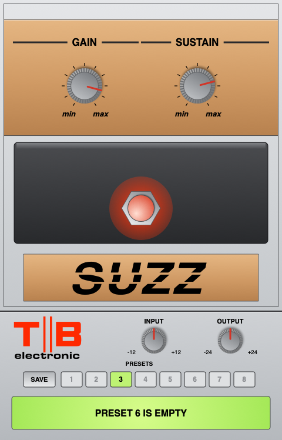

# TB Suzz (Mountain Lion VST)

A model of the **Carlsbro Suzz** fuzz pedal as a **VST 2.4, 64-bit Intel plugin for
Mac OS X 10.8.5** (Pro Tools 11 through Blue Cat PatchWork). Non-commercial, for
personal use. Built and tested on GitHub Actions.

## The circuit

Modelled from Gottfried Divos's drawing of the Carlsbro Suzz (version 1.0, 13.12.2006).
The drawing itself isn't included here: its notice asks that it isn't published on the web.

- Input: C1 10n into IC1 pin 3, biased at half the 9 V battery by R1 / R2 120K.
- IC1 (CA741CE), non-inverting: R3 470K with C3 47p (styroflex) from the output to pin 2,
  then R4 470R and C2 1u to **SUSTAIN** (P1, 22K reverse log, wired as a rheostat).
  Gain is 1 + 470K / (470R + P1): about x22 (27 dB) at min, x1000 (60 dB) at max.
- Output: C4 4u7, R5 100K to ground, R6 3K3 into C5 220n and **GAIN** (P2, only 470 ohms)
  to ground; the output is P2's wiper. R6 / P2 knock the level down by about 18 dB, and
  R6 / C5 roll off the top.
- S1, the footswitch: effect in, or the input jack straight to the output jack.

Everything above is one circuit (modified nodal analysis, trapezoidal capacitors, 4x
oversampled). The 741 is a 1 MHz integrator with 0.5 V/us slew and a soft-kneed output
swing; while it clips, C2, C3 and the output filter see the clipped output, as in the
pedal, which is where the fuzz's sustain and its slightly gated decay come from.

### Estimates (not fixed by the drawing)

Named constants in `Source/DSP/Suzz.cpp`:

| What | Value |
|---|---|
| 741 output swing on 9 V, from the 4.5 V bias | +3.0 V / -2.6 V, rounding off over the last 0.4 V |
| GAIN (P2) taper | audio (log) |
| Guitar | 6K pickup, 250K volume pot on full, 470 pF cable |

## Controls

| Panel | Parameter | What it is |
|---|---|---|
| GAIN | `Gain` | P2, the output level (0-10, marked min/max as on the pedal) |
| SUSTAIN | `Sustain` | P1, IC1's gain (0-10, marked min/max) |
| Stomp switch | `Effect` | S1: In / Out (true bypass). Glows red when the effect is in |
| INPUT (strip) | `Input` | -12..+12 dB into the pedal (1.0 in the DAW = 1 V) |
| OUTPUT (strip) | `Output` | -24..+24 dB after it |

Gain defaults to 8.5, where the effect comes out at about the same level as the bypass.
Eight preset slots (SAVE, then a slot) live in
`~/Library/Application Support/TB/TB Suzz/Presets.txt`, shared by every instance.

## Install

1. GitHub -> **Actions** -> the latest green run -> **Artifacts** -> `TB-Suzz-mac-vst`.
2. Unzip it (twice: GitHub zips the zip) to get `TB Suzz.vst`.
3. Copy `TB Suzz.vst` to `/Library/Audio/Plug-Ins/VST/`.
4. Rescan in Blue Cat PatchWork and load **TB Suzz**.

## Building and testing

- `make -C Tests run vst-run` - DSP tests (bias, response, clipping, sustain, bypass, stability, automation, CPU, demo WAVs in `Tests/renders`), presets, and
  the plugin in a mini VST host. `make -C Tests asan` runs them under the sanitizers.
- `scripts/build_vst_mac.sh` (on a Mac) builds the bundle for 10.8 and fails unless the
  binary declares 10.8 as its minimum and links only libraries that exist on 10.8.
- The workflow does both, opens the panel offscreen and clicks every control, and
  publishes the screenshots to the `gui-preview` branch.

VST ID `TBsz`. Plain C++98 DSP, no Steinberg SDK (own ABI declarations in `vst2_abi.h`).
